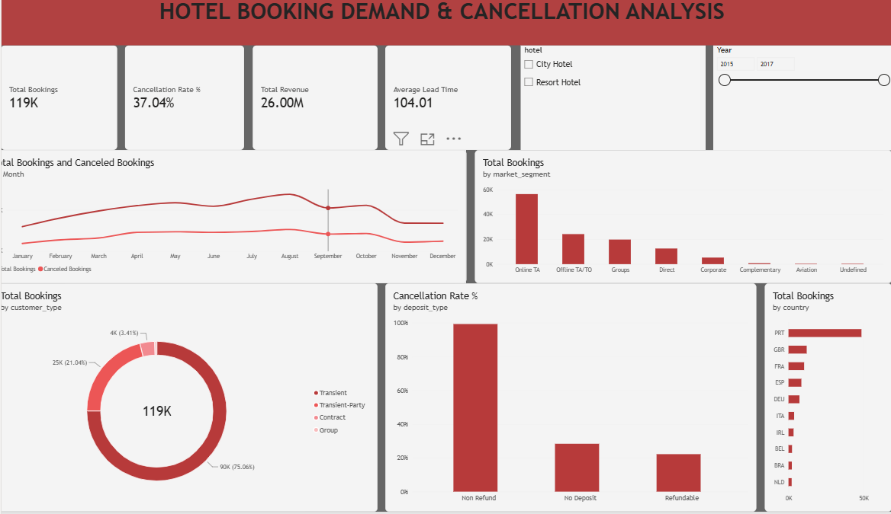

# 🏨 Hotel Booking Demand & Cancellation Analysis (Power BI)

## 📌 Project Overview
This project analyzes **119,390+ hotel booking records** across City Hotels and Resort Hotels to uncover booking seasonality, customer demographics, revenue drivers, and the root causes behind high cancellation rates. Designed an executive-level interactive Power BI dashboard to support data-driven revenue and occupancy strategies.

---

## 🎯 Key Business Questions Answered
1. What is the overall booking volume, total realized revenue, and cancellation rate?
2. How does hotel demand fluctuate across different months of the year?
3. Which market segments and customer types drive the highest volume of bookings?
4. How do deposit types and booking lead times impact cancellation behavior?
5. Which countries generate the highest number of hotel guests?

---

## 🛠️ Tools & Techniques Used
- **Power Query (ETL):** Cleaned raw booking data, handled missing/null values, removed duplicates, and engineered a unified `Arrival Date` column from separate year, month, and day fields.
- **DAX (Data Analysis Expressions):** Built dynamic measures for KPI tracking and interactive filtering:
  - `Total Bookings = COUNTROWS(Bookings)`
  - `Canceled Bookings = CALCULATE(COUNTROWS(Bookings), Bookings[is_canceled] = 1)`
  - `Cancellation Rate % = DIVIDE([Canceled Bookings], [Total Bookings], 0)`
  - `Total Revenue = SUMX(Bookings, Bookings[adr] * (Bookings[stays_in_weekend_nights] + Bookings[stays_in_week_nights]))`
  - `Average Lead Time = AVERAGE(Bookings[lead_time])`
- **Data Visualization & UX:** Designed a clean, executive layout featuring 4 KPI cards, 5 interactive visuals (Line, Column, Bar, and Donut charts), and dynamic slicers (`Hotel Type` and `Arrival Year`).

---

## 📊 Key Insights & Findings
- **High Cancellation Rate:** Out of **119K total bookings**, **37.04%** were canceled, resulting in significant potential revenue loss against the **$26.00M** realized revenue[cite: 16].
- **Lead Time Impact:** The average lead time is **104.01 days**, indicating that bookings made more than 3 months in advance carry a substantially higher risk of cancellation[cite: 16].
- **Seasonality Trends:** Demand peaks during the summer months (**May–August**, peaking in August) and drops sharply during winter (**November–January**)[cite: 16].
- **Channel & Customer Dominance:** **Online Travel Agencies (Online TA)** account for the largest share of bookings, while **Transient** travelers make up **75.06% (90K)** of total guests[cite: 16].
- **Deposit Type Anomaly:** Bookings under the **Non-Refund** deposit category exhibit a near-100% cancellation rate, largely driven by bulk group/agency block cancellations[cite: 16].
- **Top Geographic Markets:** **Portugal (PRT)** leads booking volume, followed by the **United Kingdom (GBR)**, **France (FRA)**, and **Spain (ESP)**[cite: 16].

---

## 💡 Strategic Recommendations
1. **Mitigate Long-Lead Cancellations:** Introduce stricter cancellation windows or tiered partial deposits for bookings made more than 90 days in advance.
2. **Audit Non-Refund & OTA Policies:** Review bulk-booking agreements with Online Travel Agencies to reduce high-volume cancellations in the `Non-Refund` segment.
3. **Boost Off-Season Occupancy:** Launch targeted promotional campaigns and weekend getaway packages during the November–January slump to stabilize year-round revenue.

---

## 📂 Repository Structure
- `Hotel_Booking_Demand_Analysis.pbix` — Complete Power BI Desktop report file.
- `dashboard.png` — High-resolution export of the final executive dashboard.
- `README.md` — Project documentation, DAX logic, and business insights.
